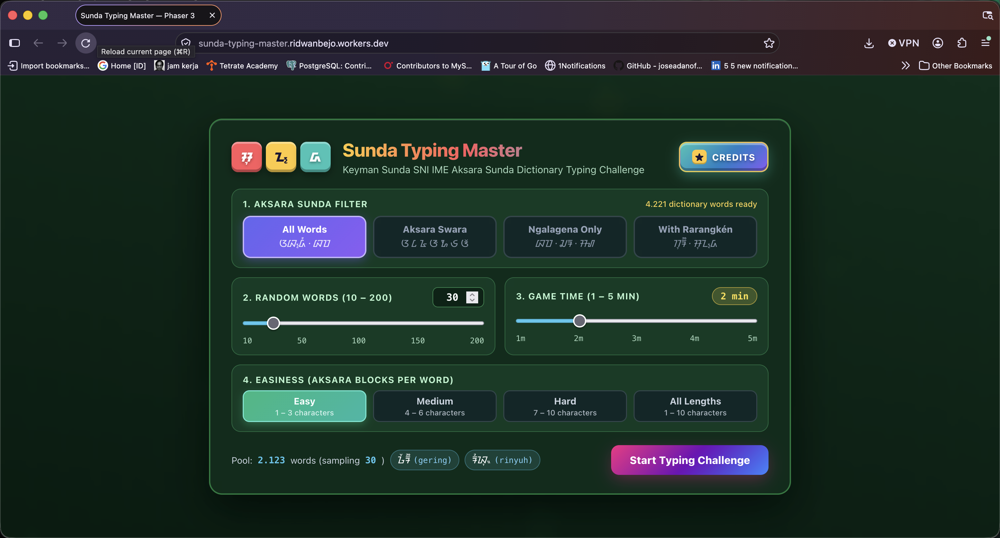
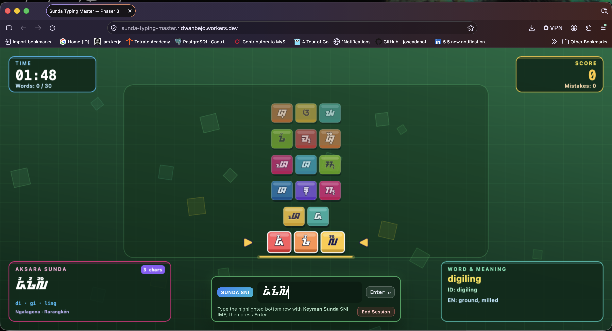
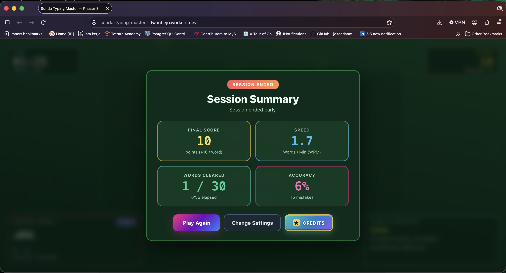
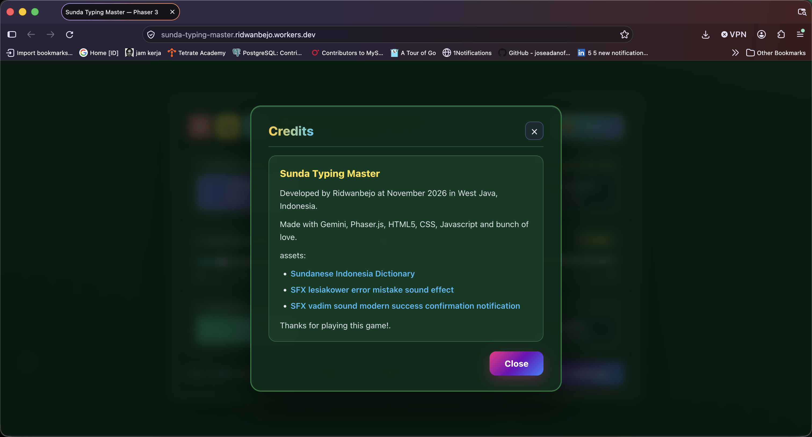

# Sunda Typing Master

## A. Overview

Developed by Ridwanbejo, this game is made with Gemini, Phaser.js, HTML5, CSS, Javascript. 

The motivation behind this game is that I can't find any games or applications that offer Sundanese Characters typing practice. Sundanese Characters or natively called as Aksara Sunda are consists of Aksara Ngalagena (consonant), Aksara Swara (vocal), Aksara Rarangkén (vocal modifier).

## B. Features & Requirements

- 4000++ Sundanese words
- translation Bahasa Indonesia and English
- Aksara Sunda Filter: all words, Aksara Swara, Ngalagena Only, with Rarangkén
- Random Words picker with minimum 10 words and max 200 words
- Adjustable game time from 1 minute to 5 mintues
- Adjustable level: easy, medium, hard, all level
- in-game word and meaning minimap
- in-game syllables minimap

Requirements:

- Laptop or PC with Widescreen (not design for Mobile screen)
- [Keyman for multilingual keyboard system](https://inurwansah.my.id/keyboards/sunda-sni/)
- [Ilham Nurwansah - Sundanese SNI Keyboard Input - SNI 9048:2021 (load the driver into Keyman)](https://www.kairaga.com/download/keyboard-sunda-sni/)

Once you are ready with the Keyman and Sundanese SNI Keyboard input setup. You can play this game as many as you can.

Check the game [>> here <<](https://sunda-typing-master.ridwanbejo.workers.dev/)

## C. Screenshots

- Game start screen.

- In-game screen.

- Game over screen.

- Credits.

---

Thanks for your participation.

ᮠᮒᮥᮁ ᮔᮥᮠᮥᮔ᮪ ᮒᮧᮞ᮪ ᮞᮥᮙ᮪ᮕᮤᮀ 🙏.
|᮲᮱| ᮔᮧᮗᮦᮙ᮪ᮘᮨᮁ |᮲᮰᮲᮶|